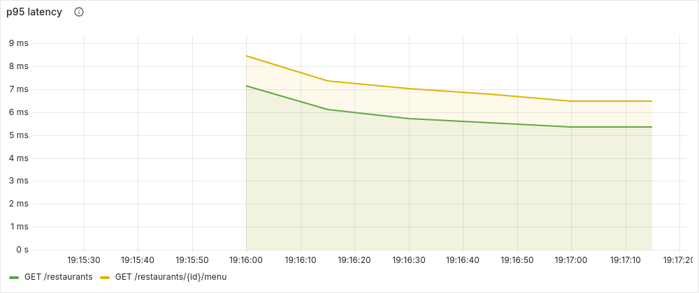
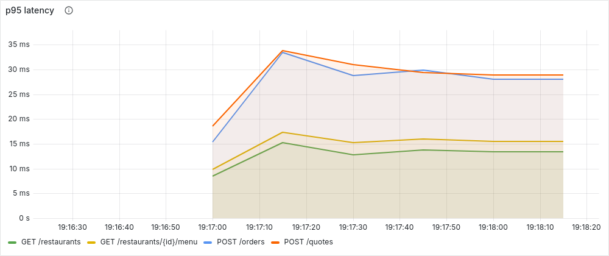
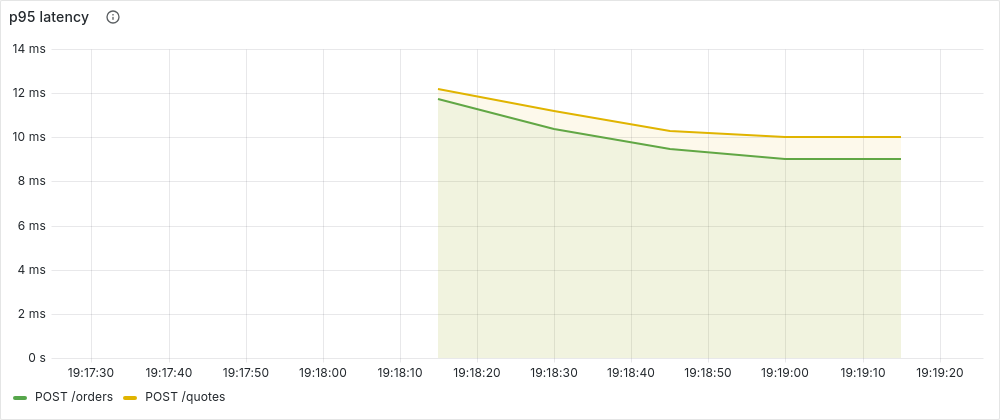
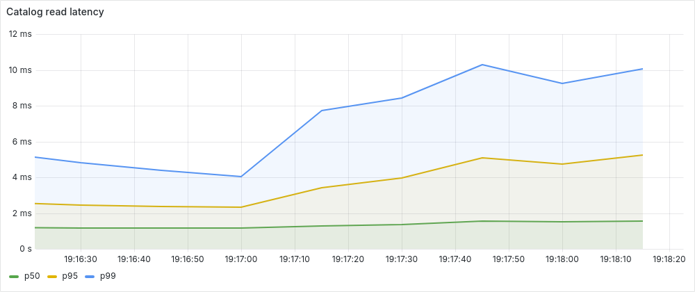
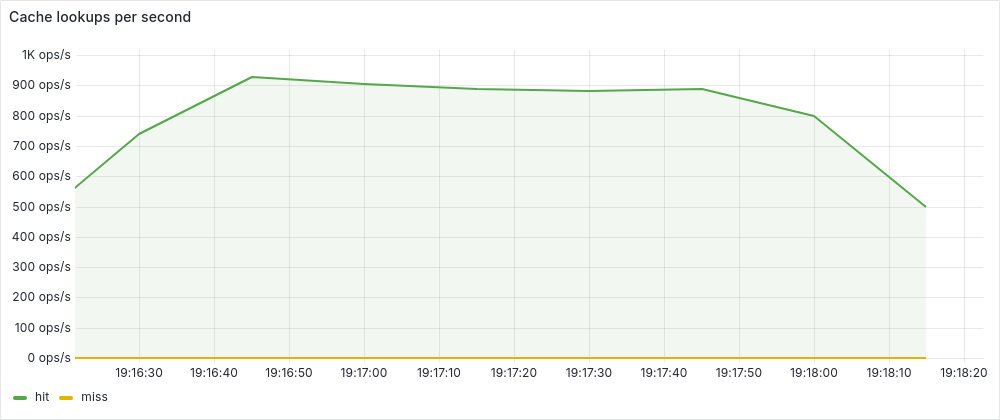
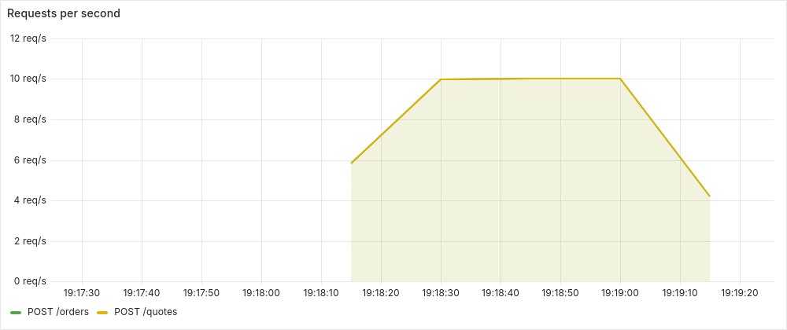
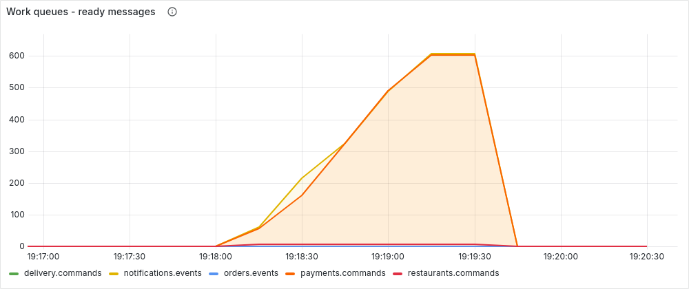
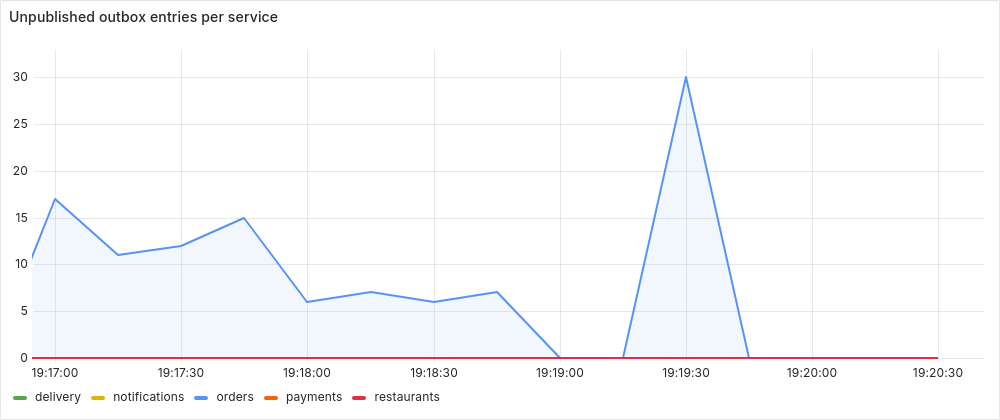
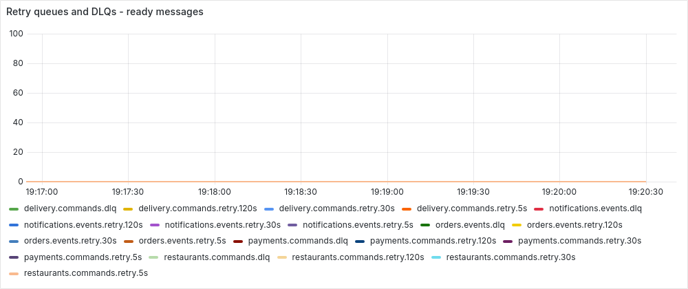
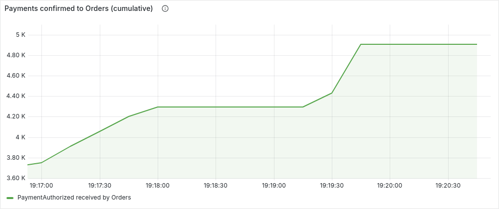

# Load test pictures

Panels of the Grafana dashboards for the run recorded in `load/results/`, rendered once with the Grafana image renderer. Times in America/Bogota.

## 1. k6: p95 latency - Catalog alone: 50 concurrent readers, no orders

95% of the requests answered faster than the line. Targets: catalog reads <= 300 ms, POST /orders <= 500 ms.

## 2. k6: p95 latency - Catalog while 10 orders per second are placed

95% of the requests answered faster than the line. Targets: catalog reads <= 300 ms, POST /orders <= 500 ms.

## 3. k6: p95 latency - 10 orders per second with Payments, Restaurant, Delivery and Notifications stopped

95% of the requests answered faster than the line. Targets: catalog reads <= 300 ms, POST /orders <= 500 ms.

## 4. Catalog service: read latency while orders are placed

Measured inside the Catalog service. Placing orders at the same time does not slow the catalog down (Feature 2).

## 5. Catalog service: Redis cache hits

Almost every read is a cache hit: the catalog is served from Redis, not from the database.

## 6. k6: orders per second with the downstream services stopped

A steady 10 orders per second were accepted (HTTP 202) although Payments, Restaurant, Delivery and Notifications were down (Feature 3).

## 7. RabbitMQ: the pending work waits in the queues and is processed later

While the services are stopped their queues grow (nothing is lost); when they start again the queues drain to 0.

## 8. Transactional outbox: every accepted order was handed to RabbitMQ

Stays near 0: the outbox relay published every message of the accepted orders even with the consumers down.

## 9. Retry queues and dead-letter queues

Stays at 0: no message failed or was sent to a DLQ during the run or the recovery.

## 10. Payments: the queued orders are charged after the service came back

Running total of payment confirmations received by Orders. Flat while Payments is stopped; when it starts again it rises by the number of orders of the run: the whole backlog is charged, once per order.

